import { Aside, Tabs, TabItem } from '@astrojs/starlight/components';
import Ref from '../../components/Ref.astro';

**Node60 is built on 6 layers, 2.0 mm, by JLCPCB, on its stackup JLC062012-1080** (<Ref id="DEC-027" />, 2026-11-03). <Ref id="DEC-023" /> made the board 2.0 mm thick because JLCPCB builds 6 and 8 layers only up to 2.0 mm, and <Ref id="DEC-024" /> shrank it to 230 × 110 mm. The outer copper weight (below) and the via option are still open. This page holds the JLCPCB prototype quotes that led to the choice (<Ref id="S34" />), taken on **2026-11-01**, with every selection on JLCPCB's quote form so they can be rebuilt by hand, the stackup JLCPCB builds for each, and the via stack.

<Aside type="caution" title="Dated observations, not quotes">
These are instant prices from JLCPCB's web form on 2026-11-01, without Gerbers. JLCPCB reviews the real files after upload and may change the price. Re-quote before ordering.
</Aside>

## Results

Five boards, 230 × 110 mm, Shengyi S1000-2M (Tg 170), ENIG, 1 oz outer and 2 oz inner copper, epoxy-filled and capped vias with a 0.20 mm minimum hole. Only the layer count and the thickness change.

| | 6 layers, 2.0 mm (chosen) | 6 layers, 1.6 mm | 8 layers, 1.6 mm | 8 layers, 2.0 mm |
|---|---:|---:|---:|---:|
| JLCPCB stackup | JLC062012-1080 | JLC061612-1080 | JLC081612-1080 | JLC082012-1080 |
| Engineering fee | $99.00 | $33.00 | $99.00 | $132.00 |
| Via covering | $0.00 | $0.00 | $0.00 | $0.00 |
| Stackup fee | – | – | $84.80 | $84.80 |
| Surface finish (ENIG) | $19.50 | $19.50 | $19.50 | $19.50 |
| Material type (S1000-2M) | $43.71 | $43.71 | $43.71 | $43.71 |
| Inner copper weight (2 oz) | $42.50 | $42.50 | $42.50 | $42.50 |
| Board | $20.60 | $16.40 | $21.00 | $25.20 |
| Min via hole size (0.20 mm) | $19.68 | $19.68 | $19.68 | $19.68 |
| 4-wire Kelvin test | $18.22 | $18.22 | $18.22 | $18.22 |
| Confirm production file | – | – | $1.05 | $1.05 |
| **Web price, 5 boards** | **$263.21** | **$193.01** | **$349.46** | **$386.66** |
| Per board | $52.64 | $38.60 | $69.89 | $77.33 |
| Desktop price ("from") | $258.21 | $188.01 | $344.46 | $381.66 |
| Build time | 7–8 days | 7–8 days | 7–8 days | 7–8 days |
| Shipping weight | 0.66 kg | 0.56 kg | 0.65 kg | 0.79 kg |

Shipping was estimated at $32.00 by UPS Express Saver (DDP), 2–4 business days, for each. Prices exclude shipping, tax and coupons.

What moves the price:

- **Thickness.** At 2.0 mm the engineering fee is $66 higher for 6 layers ($99 against $33) and $33 higher for 8 layers ($132 against $99), and the board itself costs $4 more. 1.6 mm saves $70 on 6 layers and $37 on 8.
- **8 layers with 2 oz inner copper** must use a JLCPCB stackup (Specify Stackup is fixed at Yes), which adds an $84.80 stackup fee. On the 250 × 160 mm board (2026-11-01) 8 layers with 1 oz inner had no stackup fee; that was not re-checked here.
- **The 0.20 mm via hole** adds $19.68 and forces the 4-wire Kelvin test ($18.22): $37.90 in all. The same 6 layer, 2.0 mm board with the 0.3 mm via option and no specified stackup was $225.31. JLCPCB charges nothing extra for a 0.20 or 0.25 mm hole when the via pad is 0.45 mm or more, so if the routed board keeps every via at 0.45 mm or larger, the 0.3 mm option is enough. The 0.8 mm BGA escape will probably need smaller pads (see [Via stack](#via-stack)).
- **Orders over $300** get Confirm Production File switched on and locked ($1.05): production waits until you approve JLCPCB's production file.

The 250 × 160 mm quotes of 2026-11-01 (6 layers, 1/2 oz, 2.0 mm, 0.2 mm vias, about $289) are in <Ref id="DEC-023" />. They aren't directly comparable with these: the selections were not all recorded.

<Aside type="caution" title="Open: outer copper weight">
These quotes use 1 oz outer copper, the board's current KiCad stackup. Handbook chapter 05 asks for 2 oz outer copper on high-current paths. JLCPCB offers 2 oz outer on multilayer boards, but its minimum track and space at 2 oz is 0.15 / 0.15 mm (<Ref id="S35" />), against the 0.10 mm the board's rules allow for the 0.8 mm BGA escape. Not decided here.
</Aside>

## Quote form selections

Every field on JLCPCB's quote form (<Ref id="S34" />), top to bottom, as set for each quote. No Gerber was uploaded; the size was typed in.

| Section | Field | 6 layers, 2.0 mm | 6 layers, 1.6 mm | 8 layers, 1.6 mm | 8 layers, 2.0 mm |
|---|---|---|---|---|---|
| | Select Product | Advanced PCB/PCBA (selected by itself once 6 or 8 layers is chosen) | same | same | same |
| | Base Material | FR-4 | FR-4 | FR-4 | FR-4 |
| | Layers | **6** (under High Precision PCB) | **6** | **8** | **8** |
| | Dimensions | 230 × 110 mm | 230 × 110 mm | 230 × 110 mm | 230 × 110 mm |
| | PCB Qty | 5 | 5 | 5 | 5 |
| | Product Type | Industrial/Consumer electronics | same | same | same |
| PCB Specifications | Different Design | 1 | 1 | 1 | 1 |
| | Delivery Format | Single PCB | Single PCB | Single PCB | Single PCB |
| | PCB Thickness | **2.0 mm** | **1.6 mm** | **1.6 mm** | **2.0 mm** |
| | PCB Color | Green | Green | Green | Green |
| | Silkscreen | White | White | White | White |
| | Material Type | Shengyi S1000-2M - TG170 | same | same | same |
| | Surface Finish | ENIG | ENIG | ENIG | ENIG |
| | Gold Thickness | 1 U" | 1 U" | 1 U" | 1 U" |
| High-spec Options | Outer Copper Weight | 1 oz | 1 oz | 1 oz | 1 oz |
| | Inner Copper Weight | 2 oz | 2 oz | 2 oz | 2 oz |
| | Specify Stackup | Yes | Yes | Yes (locked) | Yes (locked) |
| | Layer Stackup | **JLC062012-1080** | **JLC061612-1080** | **JLC081612-1080** (only choice) | **JLC082012-1080** (only choice) |
| | Impedance Control | No requirement | same | same | same |
| | Via Covering | Epoxy Filled & Capped | same | same | same |
| | Min via hole size/diameter | 0.2mm/(0.3/0.35mm) | same | same | same |
| | Board Outline Tolerance | ±0.2mm (Regular) | same | same | same |
| | Confirm Production file | No | No | Yes (locked: order over $300) | Yes (locked) |
| | Mark on PCB | Remove Mark | same | same | same |
| | Electrical Test | Flying Probe Fully Test | same | same | same |
| | Gold Fingers | No | No | No | No |
| | Castellated Holes | No | No | No | No |
| | Press-Fit Hole | No | No | No | No |
| | Edge Plating | No | No | No | No |
| | Blind Slots | No | No | No | No |
| | UL Marking | No | No | No | No |
| | Backdrill | No | No | No | No |
| | Humidity Indicator Card | No | No | No | No |
| Advanced Options | 4-Wire Kelvin Test | Yes (locked by the 0.2 mm via) | same | same | same |
| | Paper between PCBs | No | No | No | No |
| | Appearance Quality | IPC Class 2 Standard | same | same | same |
| | Silkscreen Technology | Ink-jet Printing Silkscreen | same | same | same |
| | Package Box | With JLCPCB logo | same | same | same |
| | Inspection Report | No | No | No | No |
| | PCB Remark | (empty) | (empty) | (empty) | (empty) |
| | PCB Assembly | off | off | off | off |
| | Stencil | off | off | off | off |
| | PCB Build Time | 7–8 days (the only choice) | same | same | same |

**When rebuilding a quote, check the form after every change.** It resets fields without saying so:

- Choosing 6 or 8 layers switches the product to Advanced PCB/PCBA. The material starts at FR4 TG135 on 6 layers; pick Shengyi S1000-2M. With the 0.2 mm via on 6 layers JLCPCB requires Tg 155 or better and greys out the TG135 and NP-140F materials.
- Changing the thickness sets Specify Stackup back to No on 6 layers.
- Going from 6 to 8 layers set the surface finish back to OSP.
- Going from 1.6 to 2.0 mm on 8 layers set the inner copper back to 0.5 oz.

Set the fields in this order to avoid most of it: layers, dimensions, thickness, material, surface finish, inner copper, Specify Stackup and the stackup, via size. Then compare the charge details with the table above.

## Stackups

JLCPCB's own stackup tables, as the quote form shows them (Specify Stackup → View Stackup). Thicknesses are JLCPCB's figures; the finished board is ±10 % (<Ref id="S35" />). Copper is the finished thickness: 1 oz outer is 0.035 mm, 2 oz inner 0.061 mm. The laminate is Shengyi S1000-2M; JLCPCB's generic FR-4 figures are Dk 4.16 for 2116 prepreg, 4.1 for 3313 and 4.4 for 7628.

<Tabs>
<TabItem label="6 L, 2.0 mm (chosen)">

**JLC062012-1080**, chosen in <Ref id="DEC-027" /> and already in `node60.kicad_pcb`. The layer roles are placement decision D12-1's (user, 2026-11-03). JLCPCB also offers JLC062012-3313 and JLC062012-2116 at this thickness (not viewed).

| JLCPCB layer | KiCad layer | Material | Thickness (mm) | Role |
|---|---|---|---:|---|
| Top Layer | F.Cu | Copper, 1 oz | 0.035 | Signals, small parts |
| Prepreg | | 1080 × 1 | 0.084 | |
| Prepreg | | 1080 × 1 | 0.0535 | |
| Inner Layer L2 | In1.Cu | Copper, 2 oz | 0.061 | GND |
| Core | | Core (0.55 mm 2/2 oz without copper) | 0.55 | |
| Inner Layer L3 | In2.Cu | Copper, 2 oz | 0.061 | VBAT_PROT |
| Prepreg | | 2116 × 1 | 0.0935 | |
| Prepreg | | 2116 × 1 | 0.124 | |
| Prepreg | | 2116 × 1 | 0.0935 | |
| Inner Layer L4 | In3.Cu | Copper, 2 oz | 0.061 | VBAT_PROT |
| Core | | Core (0.55 mm 2/2 oz without copper) | 0.55 | |
| Inner Layer L5 | In4.Cu | Copper, 2 oz | 0.061 | GND |
| Prepreg | | 1080 × 1 | 0.0535 | |
| Prepreg | | 1080 × 1 | 0.084 | |
| Bottom Layer | B.Cu | Copper, 1 oz | 0.035 | Signals, most parts |
| | | **Sum** | **2.000** | |

</TabItem>
<TabItem label="6 L, 1.6 mm">

**JLC061612-1080.** Same layer order and roles as 2.0 mm; the cores are 0.35 mm and the centre prepreg is 1080/7628/1080. The other choice, JLC061612-1080A, differs by a few µm per prepreg (0.086 / 0.0555 / 0.216 mm) and is a "special stackup" that JLCPCB's economic assembly doesn't support; it was not chosen.

| JLCPCB layer | KiCad layer | Material | Thickness (mm) | Role |
|---|---|---|---:|---|
| Top Layer | F.Cu | Copper, 1 oz | 0.035 | Signals, small parts |
| Prepreg | | 1080 × 1 | 0.084 | |
| Prepreg | | 1080 × 1 | 0.0535 | |
| Inner Layer L2 | In1.Cu | Copper, 2 oz | 0.061 | GND |
| Core | | Core (0.35 mm 2/2 oz without copper) | 0.35 | |
| Inner Layer L3 | In2.Cu | Copper, 2 oz | 0.061 | VBAT_PROT |
| Prepreg | | 1080 × 1 | 0.0535 | |
| Prepreg | | 7628 × 1 | 0.218 | |
| Prepreg | | 1080 × 1 | 0.0535 | |
| Inner Layer L4 | In3.Cu | Copper, 2 oz | 0.061 | VBAT_PROT |
| Core | | Core (0.35 mm 2/2 oz without copper) | 0.35 | |
| Inner Layer L5 | In4.Cu | Copper, 2 oz | 0.061 | GND |
| Prepreg | | 1080 × 1 | 0.0535 | |
| Prepreg | | 1080 × 1 | 0.084 | |
| Bottom Layer | B.Cu | Copper, 1 oz | 0.035 | Signals, most parts |
| | | **Sum** | **1.614** | |

</TabItem>
<TabItem label="8 L, 1.6 mm">

**JLC081612-1080**, the only stackup JLCPCB offers for 8 layers, 1.6 mm, 1/2 oz. A "special stackup": JLCPCB's economic assembly doesn't support it. Layer roles for 8 layers aren't assigned yet.

| JLCPCB layer | KiCad layer | Material | Thickness (mm) |
|---|---|---|---:|
| Top Layer | F.Cu | Copper, 1 oz | 0.035 |
| Prepreg | | 1080 × 1 | 0.086 |
| Prepreg | | 1080 × 1 | 0.086 |
| Prepreg | | 1080 × 1 | 0.0555 |
| Inner Layer L2 | In1.Cu | Copper, 2 oz | 0.061 |
| Core | | Core (0.10 mm 2/2 oz without copper) | 0.10 |
| Inner Layer L3 | In2.Cu | Copper, 2 oz | 0.061 |
| Prepreg | | 1080 × 1 | 0.0555 |
| Prepreg | | 1080 × 1 | 0.086 |
| Prepreg | | 1080 × 1 | 0.0555 |
| Inner Layer L4 | In3.Cu | Copper, 2 oz | 0.061 |
| Core | | Core (0.10 mm 2/2 oz without copper) | 0.10 |
| Inner Layer L5 | In4.Cu | Copper, 2 oz | 0.061 |
| Prepreg | | 1080 × 1 | 0.0555 |
| Prepreg | | 1080 × 1 | 0.086 |
| Prepreg | | 1080 × 1 | 0.0555 |
| Inner Layer L6 | In5.Cu | Copper, 2 oz | 0.061 |
| Core | | Core (0.10 mm 2/2 oz without copper) | 0.10 |
| Inner Layer L7 | In6.Cu | Copper, 2 oz | 0.061 |
| Prepreg | | 1080 × 1 | 0.0555 |
| Prepreg | | 1080 × 1 | 0.086 |
| Prepreg | | 1080 × 1 | 0.086 |
| Bottom Layer | B.Cu | Copper, 1 oz | 0.035 |
| | | **Sum** | **1.707** |

</TabItem>
<TabItem label="8 L, 2.0 mm">

**JLC082012-1080**, the only stackup JLCPCB offers for 8 layers, 2.0 mm, 1/2 oz. A "special stackup", like the 1.6 mm one. Layer roles for 8 layers aren't assigned yet.

| JLCPCB layer | KiCad layer | Material | Thickness (mm) |
|---|---|---|---:|
| Top Layer | F.Cu | Copper, 1 oz | 0.035 |
| Prepreg | | 1080 × 1 | 0.084 |
| Prepreg | | 1080 × 1 | 0.0535 |
| Inner Layer L2 | In1.Cu | Copper, 2 oz | 0.061 |
| Core | | Core (0.30 mm 2/2 oz without copper) | 0.30 |
| Inner Layer L3 | In2.Cu | Copper, 2 oz | 0.061 |
| Prepreg | | 1080 × 1 | 0.0535 |
| Prepreg | | 1080 × 1 | 0.084 |
| Prepreg | | 1080 × 1 | 0.0535 |
| Inner Layer L4 | In3.Cu | Copper, 2 oz | 0.061 |
| Core | | Core (0.30 mm 2/2 oz without copper) | 0.30 |
| Inner Layer L5 | In4.Cu | Copper, 2 oz | 0.061 |
| Prepreg | | 1080 × 1 | 0.0535 |
| Prepreg | | 1080 × 1 | 0.084 |
| Prepreg | | 1080 × 1 | 0.0535 |
| Inner Layer L6 | In5.Cu | Copper, 2 oz | 0.061 |
| Core | | Core (0.30 mm 2/2 oz without copper) | 0.30 |
| Inner Layer L7 | In6.Cu | Copper, 2 oz | 0.061 |
| Prepreg | | 1080 × 1 | 0.0535 |
| Prepreg | | 1080 × 1 | 0.084 |
| Bottom Layer | B.Cu | Copper, 1 oz | 0.035 |
| | | **Sum** | **2.115** |

</TabItem>
</Tabs>

## Via stack

The same in all four quotes. JLCPCB's standard multilayer process makes through vias only; blind, buried and laser microvias are its separate HDI product and weren't quoted.

| | Value | Source |
|---|---|---|
| Via type | Through, F.Cu to B.Cu (L1–L6 or L1–L8); no blind, buried or micro vias; no backdrill | Quote form |
| Barrel length | Board thickness: 2.0 or 1.6 mm | |
| Minimum drill | 0.20 mm (KiCad rule `min_through_hole_diameter`); Default class 0.25 mm. Via presets in the PCB editor: 0.35/0.20, 0.40/0.20, 0.45/0.25, 0.60/0.30 and 0.80/0.40 mm (see [KiCad PCB settings](../pcb-settings/)) | `node60.kicad_pro` |
| Minimum pad | 0.35 mm (rule `min_via_diameter`, annular ring ≥ 0.075 mm); Default class 0.45 mm. JLCPCB wants the pad 0.10 mm larger than the hole, 0.15 mm preferred | `node60.kicad_pro`, <Ref id="S35" /> |
| Aspect ratio at 0.20 mm | 10 : 1 at 2.0 mm, 8 : 1 at 1.6 mm | |
| Quote option | Min via hole size/diameter 0.2mm/(0.3/0.35mm): $19.68 plus the forced 4-wire Kelvin test, $18.22 | Quote form |
| Hole plating | 18 µm average | <Ref id="S35" /> |
| Fill and cap | Epoxy filled and copper capped, free on 6 layers and up. Tented vias up to 0.5 mm and untented vias up to 0.3 mm are filled. Capped vias can sit in pads, including the BGA's | Quote form, <Ref id="S35" /> |
| Tenting, filling, capping | Tented both sides, filled and capped (`node60.kicad_pcb` via protection; filling and capping set 2026-11-04 to match the order) | `node60.kicad_pcb` |
| Inner-layer clearance | Via hole to copper ≥ 0.20 mm, so plane antipads ≥ hole + 0.40 mm (0.60 mm for a 0.20 mm hole) | <Ref id="S35" /> |
| Hole to hole | Via to via ≥ 0.20 mm; pad holes ≥ 0.45 mm | <Ref id="S35" /> |
| Track and space by copper | 1 oz multilayer: 0.09 / 0.09 mm (0.076 mm allowed in BGA fan-outs). 2 oz: 0.15 / 0.15 mm, so any signal routed on a 2 oz inner layer needs 0.15 mm | <Ref id="S35" /> |
| PTH annular ring | 1 oz multilayer: 0.20 mm recommended, 0.15 mm minimum; 2 oz: 0.254 mm (applies to the AT13/ATM13 and other through-hole pads on the 2 oz inner layers) | <Ref id="S35" /> |

The small via option is there for the S32K344's 0.8 mm-pitch LFBGA-257 (0.34 mm ball pads). Dog-bone vias sit on a 0.8 mm grid between the balls. A 0.45 mm via pad still clears the balls (0.17 mm), but leaves only 0.35 mm between neighbouring vias; passing one 0.10 mm track between them at the Default class's 0.15 mm clearance needs a via pad of 0.40 mm or less, and JLCPCB charges the via surcharge for any pad under 0.45 mm. If the BGA is fanned out with vias in the pads instead (capped vias allow it), the argument changes; the routing will decide.

## Screenshots

The quote form as set for each quote, 2026-11-01. Each tab shows the form from top to bottom with the charge details on the right, then the stackup.

<Tabs>
<TabItem label="6 L, 2.0 mm">

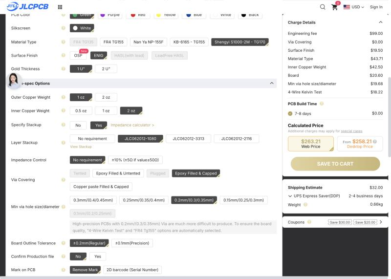

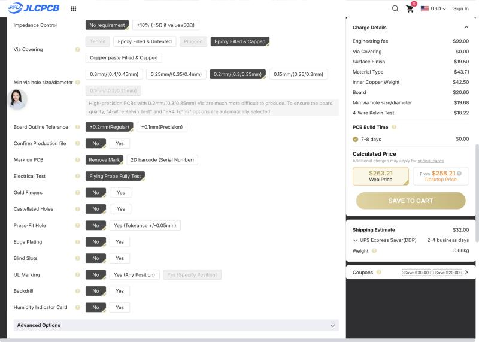

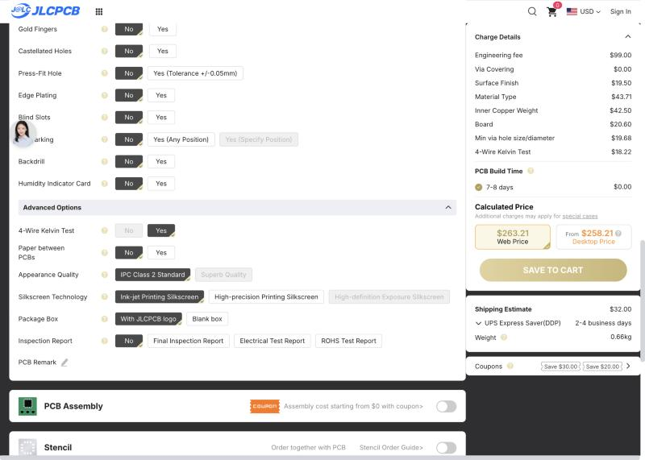

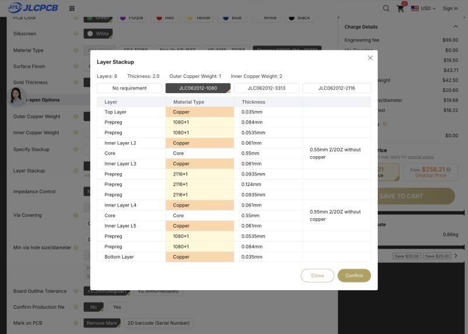

</TabItem>
<TabItem label="6 L, 1.6 mm">

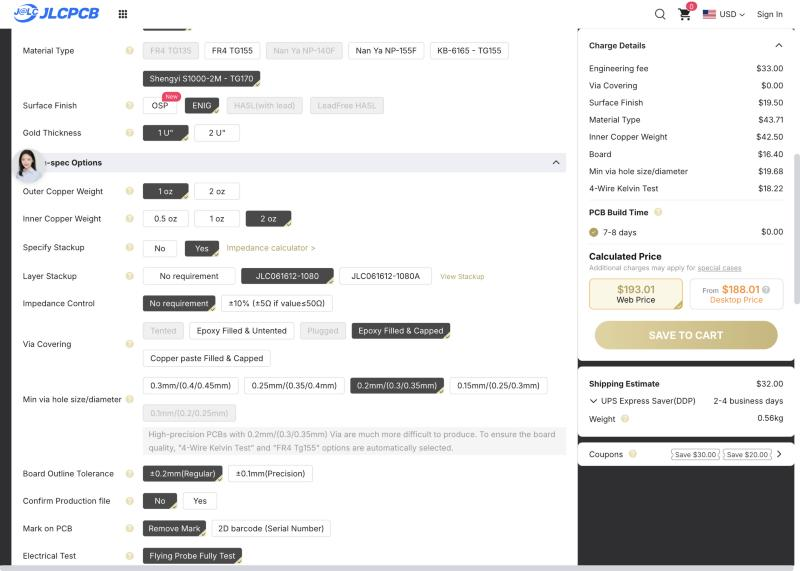

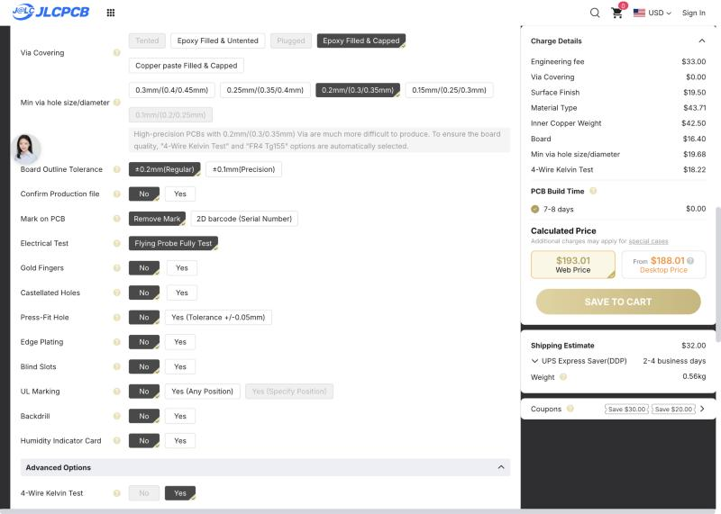

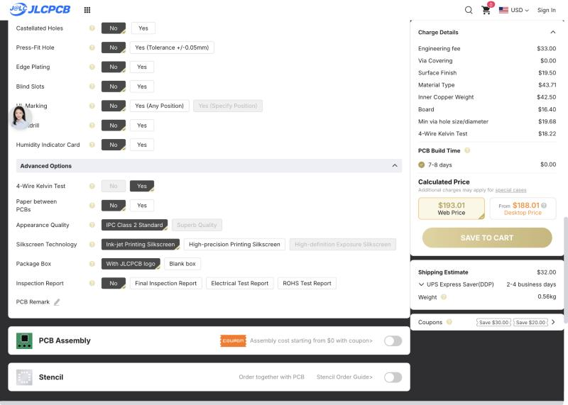

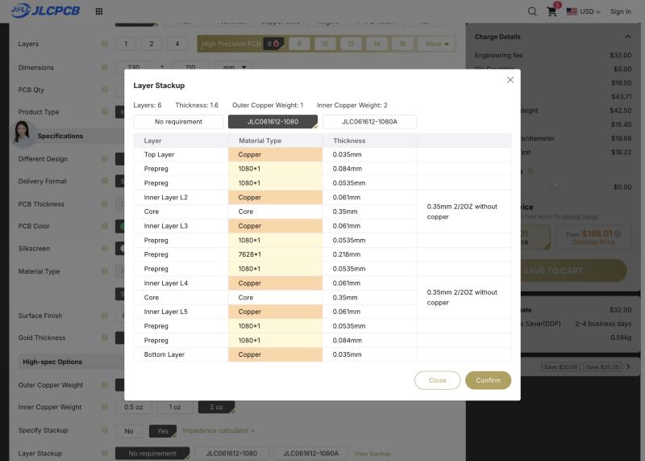

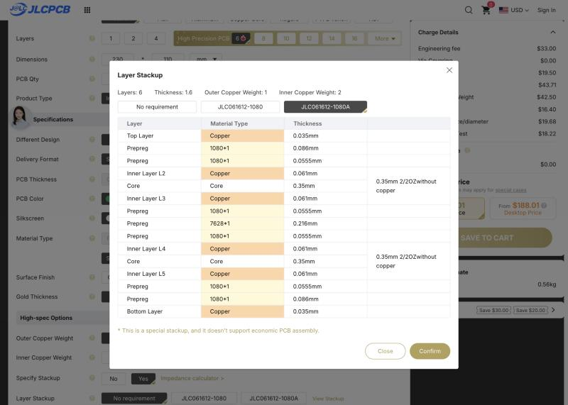

</TabItem>
<TabItem label="8 L, 1.6 mm">

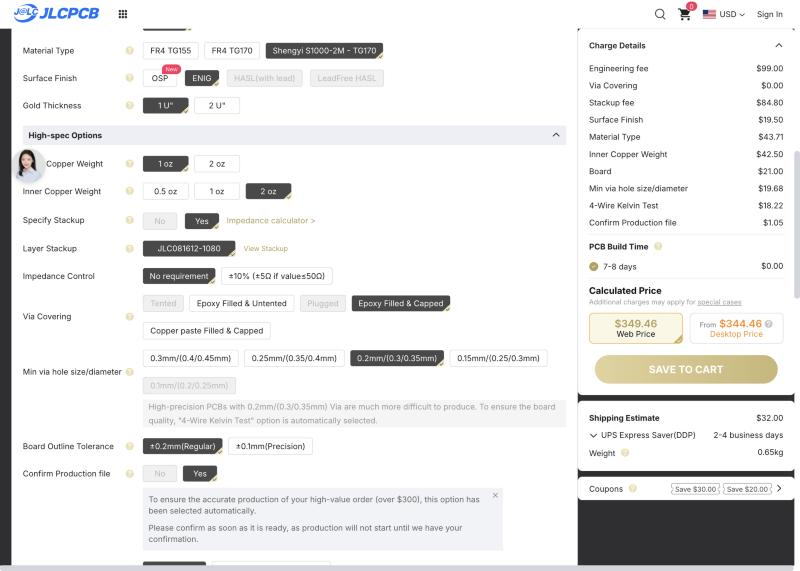

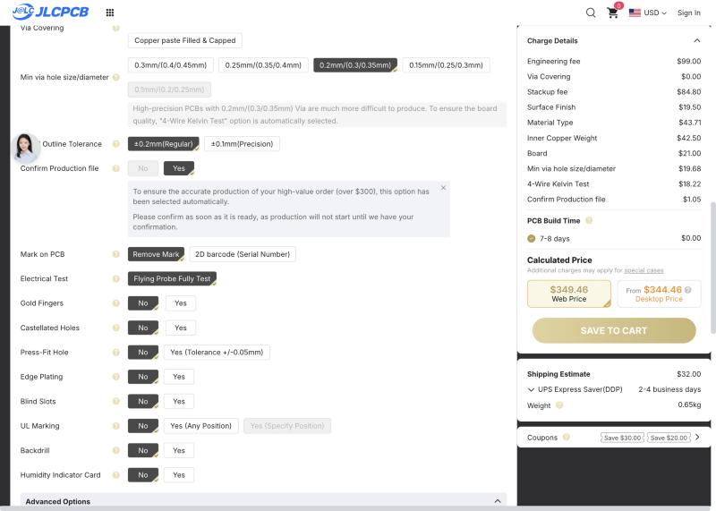

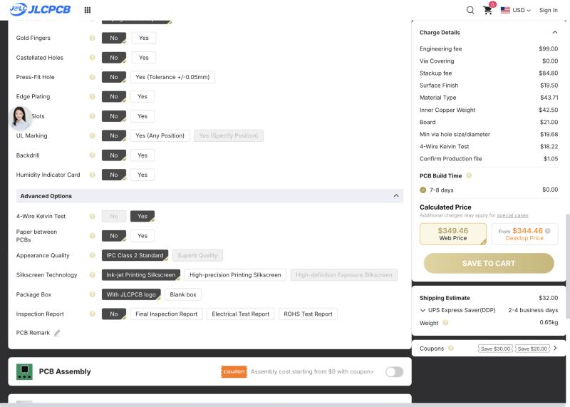

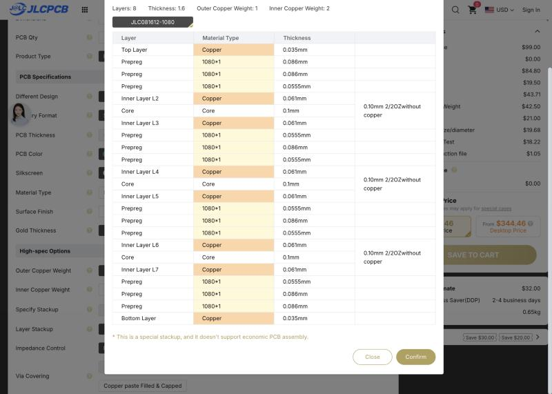

</TabItem>
<TabItem label="8 L, 2.0 mm">

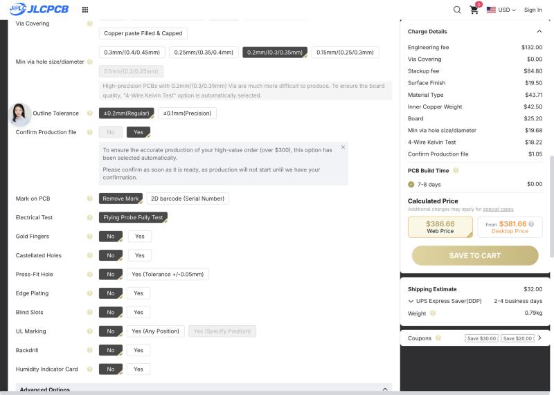

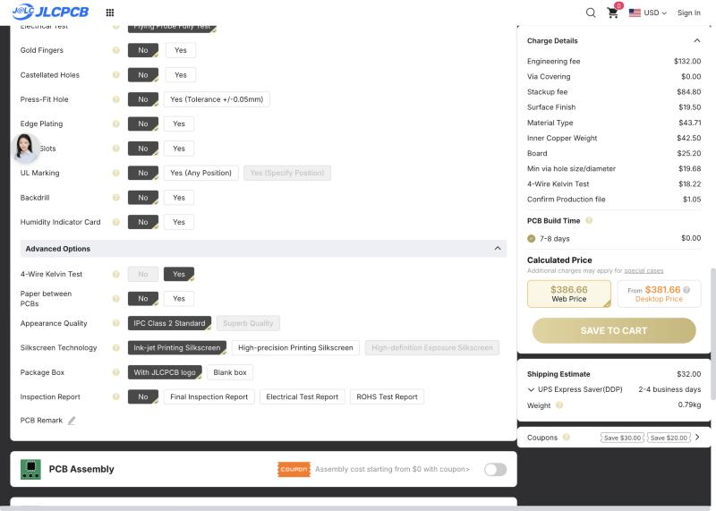

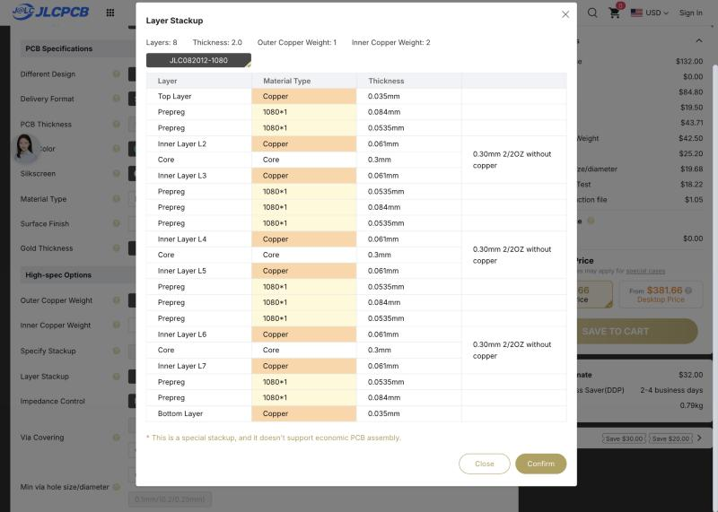

</TabItem>
</Tabs>
