import { Aside } from '@astrojs/starlight/components';
import Ref from '../../components/Ref.astro';

This page lists every setting in Node60's KiCad 10 board project, with the value, JLCPCB's limit for the chosen process (<Ref id="DEC-027" />: 6 layers, 2.0 mm, JLC062012-1080, 1 oz outer and 2 oz inner copper; capabilities from <Ref id="S35" />, read 2026-11-04) and the reason for each value. With it, someone could rebuild the setup by hand in a new project. Every value was read back from KiCad on 2026-11-04.

The settings live in three files at the repo root:

| File | Holds | KiCad menu |
|---|---|---|
| `node60.kicad_pcb` | Stackup, finish, solder mask, via protection | **File → Board Setup → Board Stackup** (via filling and capping have no control there; see [Via protection](#via-protection)) |
| `node60.kicad_pro` | Constraints, pre-defined sizes, net classes, violation severities | **File → Board Setup → Design Rules** |
| `node60.kicad_dru` | Custom rules | **File → Board Setup → Design Rules → Custom Rules** |

<Aside type="caution" title="Edit the files, then check KiCad's diff">
The repo's scripts write these settings as text edits, and CI runs DRC on them. KiCad rewrites `node60.kicad_pro` when the board editor closes, even after **Discard Changes** (seen 2026-11-04: it writes out every default), and a pcbnew save can drop settings. After using KiCad, check `git diff node60.kicad_pro` and restore the file unless you meant to change it. If KiCad is open while a setting changes on disk, close and reopen the project.
</Aside>

The pictures are KiCad 10.0's dialogs on this board, taken 2026-11-04 with the files at commit `4d44ab5`.

## Board Stackup

### Board Editor Layers

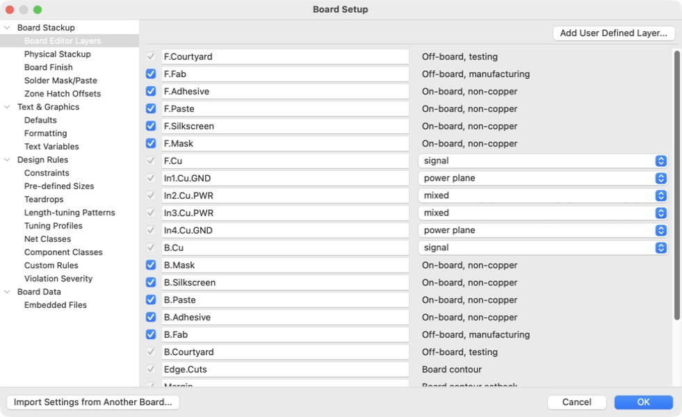

Six copper layers: F.Cu, In1.Cu–In4.Cu, B.Cu. The inner layers carry user names that show their role (`In1.Cu.GND`, `In2.Cu.PWR`, `In3.Cu.PWR`, `In4.Cu.GND`) and a KiCad layer type: F.Cu and B.Cu **signal**, In1 and In4 **power plane**, In2 and In3 **mixed**. Layer roles come from placement decisions D12-1 and D17 A; the rule areas below enforce them:

| Layer | Role |
|---|---|
| F.Cu | Top. Decoupling caps, D201, J401, the busbars' copper and the T1S trunk |
| In1.Cu | GND plane |
| In2.Cu | Signals north of y 70 mm (rule area `SIGNAL_WINDOW_In2Cu_1`), VBAT_PROT south of it |
| In3.Cu | VBAT_PROT in the power band only (x 72–238, y 71–122; 2026-11-04), nothing elsewhere |
| In4.Cu | GND plane |
| B.Cu | Bottom, where nearly every part sits |

### Physical Stackup

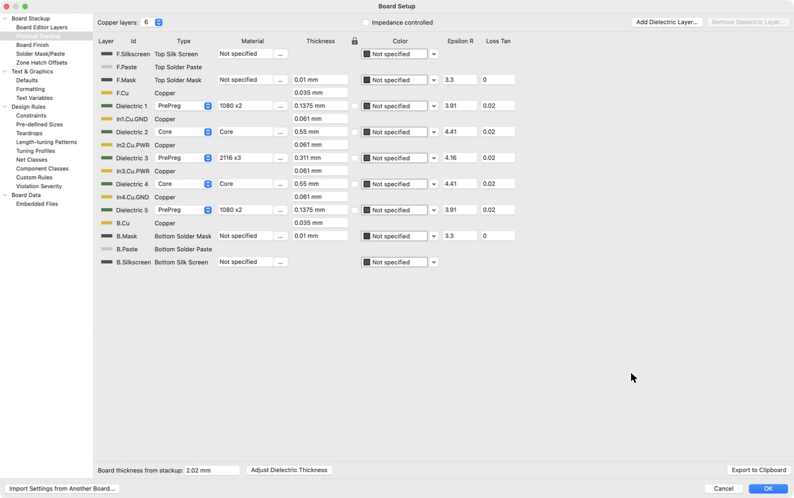

JLCPCB's JLC062012-1080, entered layer by layer. KiCad uses it for impedance and length calculations and writes it into the fab outputs.

| Layer | Type | Thickness | Material | εr | Loss tangent |
|---|---|---:|---|---:|---:|
| F.Mask | Solder mask | 0.010 mm | | | |
| F.Cu | Copper | 0.035 mm (1 oz) | | | |
| Dielectric 1 | Prepreg | 0.1375 mm | 1080 × 2 | 3.91 | 0.02 |
| In1.Cu | Copper | 0.061 mm (2 oz) | | | |
| Dielectric 2 | Core | 0.55 mm | Core | 4.41 | 0.02 |
| In2.Cu | Copper | 0.061 mm (2 oz) | | | |
| Dielectric 3 | Prepreg | 0.311 mm | 2116 × 3 | 4.16 | 0.02 |
| In3.Cu | Copper | 0.061 mm (2 oz) | | | |
| Dielectric 4 | Core | 0.55 mm | Core | 4.41 | 0.02 |
| In4.Cu | Copper | 0.061 mm (2 oz) | | | |
| Dielectric 5 | Prepreg | 0.1375 mm | 1080 × 2 | 3.91 | 0.02 |
| B.Cu | Copper | 0.035 mm (1 oz) | | | |
| B.Mask | Solder mask | 0.010 mm | | | |

KiCad shows 2.02 mm as "Board thickness from stackup": 2.00 mm of copper and dielectric plus the two 0.01 mm mask layers, so the board is the 2.0 mm JLCPCB builds. **Impedance controlled** is off, since controlled impedance isn't ordered; the T1S lines are kept short and matched instead (D16). Why 2 oz inside: the VBAT_PROT and power-entry planes carry up to 60 A, so the 2 oz inner layers halve their resistance (see [PCB stackup & fab quotes](../pcb-fabrication/)).

### Board Finish

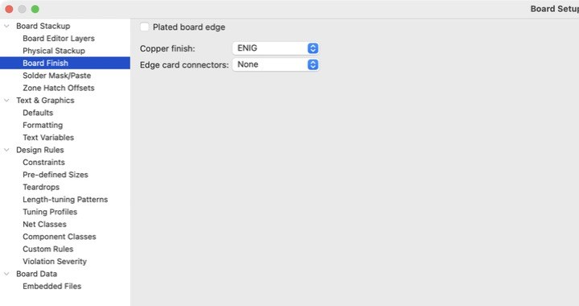

| Setting | Value | Why |
|---|---|---|
| Copper finish | ENIG | Flat pads for the 0.8 mm-pitch BGA (U401); JLCPCB requires ENIG for 0.2 mm BGA pads |
| Has plated board edge | No | Not needed |
| Edge card connector | None | Not used |

### Solder Mask/Paste

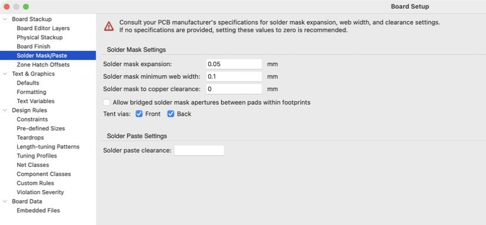

| Setting | Value | JLCPCB | Why |
|---|---|---|---|
| Solder mask expansion | 0.05 mm | — | Typical for JLCPCB; keeps the mask off the pad with registration tolerance |
| Solder mask minimum web width | 0.10 mm | Green 0.10 mm (black/white 0.13 mm) | JLCPCB's minimum for green mask; DRC flags thinner webs |
| Allow bridged solder mask apertures between pads within footprints | No | — | Keep the mask dam between fine-pitch pads |
| Solder paste clearance / ratio | 0 / 0 % | — | Footprints set their own paste |

### Via protection

KiCad 10 keeps via protection (IPC-4761) as a board setting with a per-via override. In Board Setup only **tenting** has a control (on the Solder Mask/Paste page above); the board's **filling** and **capping** values are in `node60.kicad_pcb`'s setup section, written there by text edit. Each via's own setting is in its Properties dialog (double-click a via): **Protection features: From rules** means it follows the board. All 1,463 vias on the board are set that way.

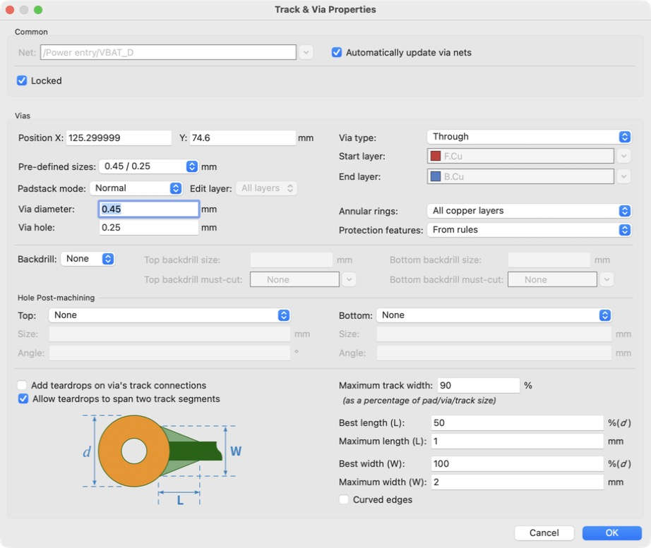


| Setting | Value | Why |
|---|---|---|
| Tenting, front and back | Yes | Mask covers every via; a via under a busbar must be covered (D01) |
| Covering | No | Not a JLCPCB option; capping does the job |
| Plugging | No | Not used; filling is |
| **Filling** | **Yes** (2026-11-04) | Matches the order: JLCPCB fills vias with epoxy at no charge on 6 layers and up |
| **Capping** | **Yes** (2026-11-04) | Matches the order: filled vias are copper capped, so vias may sit in pads. The 90 in-pad VBB vias under the output switches depend on it |

Filling and capping were off until 2026-11-04. The board was already designed and quoted for filled, capped vias, so the change only makes KiCad's fab outputs say so.

## Text & Graphics

### Defaults

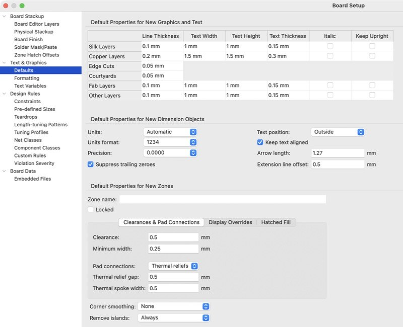

The sizes KiCad gives new text and lines. They are in `node60.kicad_pro` (`board.design_settings.defaults`). Only silk text differs from KiCad's defaults.

| Layer | Text height | Text thickness | Line width | Why |
|---|---:|---:|---:|---|
| Silkscreen | 1.0 mm | **0.15 mm** (KiCad default 0.10; set 2026-11-04) | 0.10 mm | New silk text meets JLCPCB's 1.0 / 0.15 mm minimum and the custom rule "Silk text 1.0 mm high, 0.15 mm stroke" |
| Copper | 1.5 mm | 0.30 mm | 0.20 mm | KiCad default |
| Fab | 1.0 mm | 0.15 mm | 0.10 mm | KiCad default |
| Other layers | 1.0 mm | 0.15 mm | 0.10 mm | KiCad default |
| Courtyard / board outline | | | 0.05 mm | KiCad default |

The silk line width stays at KiCad's 0.10 mm; JLCPCB asks for silk lines of 0.15 mm or more and may not print thinner ones. Footprint text keeps each footprint's own sizes (**Apply defaults to footprint text** is off).

## Design Rules

### Constraints

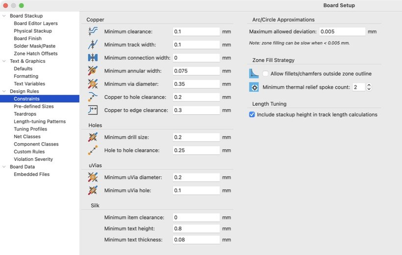

The board-wide minimums. Custom rules and net classes ask for more where they need it.

| Setting | Value | JLCPCB | Why |
|---|---|---|---|
| Minimum clearance | 0.10 mm | 1 oz: 0.09 mm | Only the BGA and PHY escapes use it (custom rule); everywhere else the Default class's 0.15 mm applies |
| Minimum track width | 0.10 mm | 1 oz: 0.09 mm | Same: the escape areas only |
| Minimum connection width | 0 | — | KiCad default |
| Minimum annular width | 0.075 mm | Via pad ≥ hole + 0.10 mm (+ 0.15 preferred) | 0.35 mm pad on a 0.20 mm hole: the smallest via JLCPCB builds with its preferred margin |
| Minimum via diameter | 0.35 mm | 0.25 mm | Smallest preset via |
| Copper to hole clearance | 0.20 mm | Via hole to track 0.20 mm | JLCPCB's figure. Plated holes of parts get 0.35 mm (custom rule) |
| Copper to edge clearance | 0.30 mm | ≥ 0.20 mm | Margin over JLCPCB's routed-edge limit |
| Minimum through hole | 0.20 mm | 0.15 mm (0.20 preferred) | JLCPCB's preferred hole; 0.20 mm is the small-via option in the quote |
| Hole to hole clearance | 0.25 mm | Via to via 0.20 mm | Margin over JLCPCB |
| Minimum uvia diameter / hole | 0.20 / 0.10 mm | — | Unused: no microvias on this process |
| Minimum thermal relief spoke count | 2 | — | KiCad default; a custom rule allows 1 for small parts' pads |
| Silk to silk clearance | 0 | — | KiCad default |
| Minimum text height / thickness | 0.8 / 0.08 mm | 1.0 / 0.15 mm | KiCad defaults; a custom rule enforces JLCPCB's 1.0 / 0.15 mm on silk text |
| Solder mask to copper clearance | 0 | — | KiCad default |
| Use height for length calculations | Yes | — | Via lengths count in tuning, which matters for the T1S pairs |

### Pre-defined Sizes

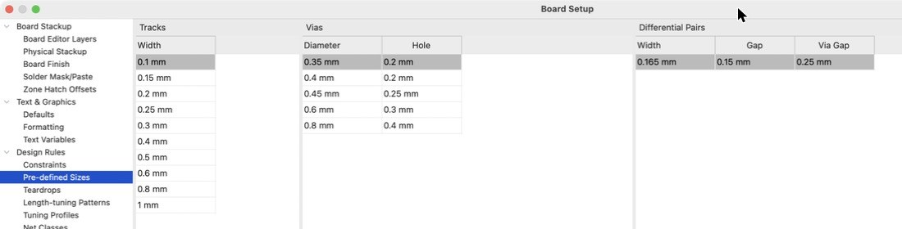

These sizes appear in the track and via drop-downs on the PCB editor's toolbar. Each is inside JLCPCB's capabilities.

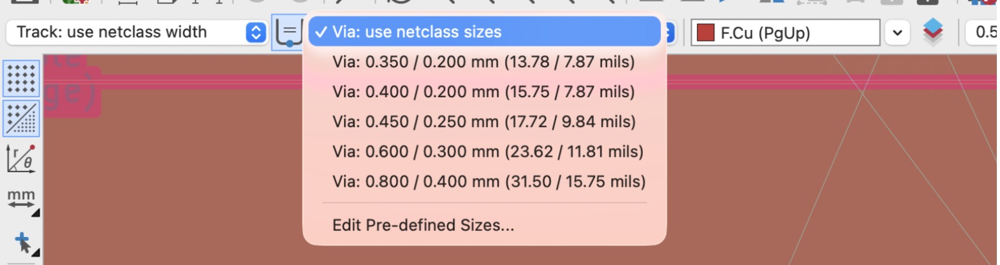


**Tracks:** 0.10, 0.15, 0.20, 0.25, 0.30, 0.40, 0.50, 0.60, 0.80, 1.00 mm.

| Track width | Use |
|---|---|
| 0.10 mm | BGA and PHY escapes only (ESCAPE_U401, ESCAPE_U501), outer 1 oz layers |
| 0.15 mm | Smallest on the 2 oz inner layers (JLCPCB 0.15 mm); routine signals |
| 0.20 mm | Default class |
| 0.25–0.30 mm | Wider signals, small currents |
| 0.40 mm | PWR_RAIL class (3V3_MAIN, 1V5_CORE, VDDAU_AON) |
| 0.60 mm | PWR_BATT and SW_NODE classes |
| 0.80–1.00 mm | Short power links where a pour won't fit |

**Vias** (diameter / hole):

| Via | Annular ring | Use |
|---|---:|---|
| 0.35 / 0.20 mm | 0.075 mm | BGA fan-out between 0.8 mm-pitch balls: leaves room for a 0.10 mm track between neighbouring vias |
| 0.40 / 0.20 mm | 0.10 mm | Dense areas outside the BGA |
| 0.45 / 0.25 mm | 0.10 mm | Default class: routine signals |
| 0.60 / 0.30 mm | 0.15 mm | Power, stitching |
| 0.80 / 0.40 mm | 0.20 mm | High-current power vias |

Vias with a 0.20 mm hole make JLCPCB add the small-via option ($19.68 plus a forced 4-wire test, $18.22, for five boards; already in the quote). Vias are through holes only: JLCPCB's multilayer process has no blind, buried or microvias.

**Differential pairs:** 0.165 mm width, 0.15 mm gap, 0.25 mm via gap: the T1S pairs (T1S_100R class).

### Net Classes

| Class | Clearance | Track | Via | Diff pair | Nets |
|---|---:|---:|---|---|---|
| Default | 0.15 mm | 0.20 mm | 0.45 / 0.25 mm | 0.20 / 0.15 mm | Everything else |
| T1S_100R | 0.15 mm | 0.165 mm | 0.45 / 0.25 mm | 0.165 / 0.15 mm | `/T1S_P`, `/T1S_N`, `/T1S/T1S_*_P`, `/T1S/T1S_*_N`, `/T1S/T1S_*_DROP`, `/T1S/T1S_*_END` |
| PWR_BATT | 0.15 mm | 0.60 mm | 0.45 / 0.25 mm | — | `/VBAT_IN`, `VBAT_D`, `VBAT_Q2D`, `VBAT_PROT`, `/OUT*` |
| PWR_RAIL | 0.15 mm | 0.40 mm | 0.45 / 0.25 mm | — | `3V3_MAIN`, `1V5_CORE`, `VDDAU_AON`, `VBAT_FILT` |
| SW_NODE | 0.15 mm | 0.60 mm | 0.45 / 0.25 mm | — | `/Regulators/3V3_MAIN_SW`, `/Regulators/1V5_CORE_SW` |

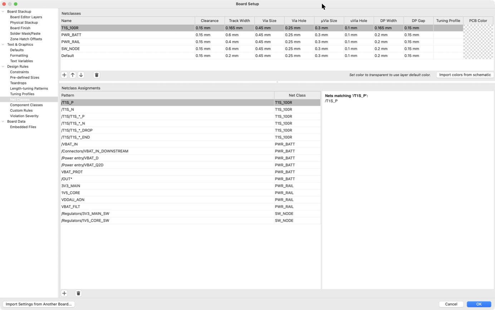

Every class has 0.3 / 0.1 mm microvia values (KiCad's defaults, unused) and no tuning profile or colour. The power classes' widths are for tracks drawn by hand; the power nets themselves are carried by pours (`scripts/draw_power.py`). The T1S pair width and gap were picked for coupling and space, not impedance (no impedance control ordered).

### Custom Rules

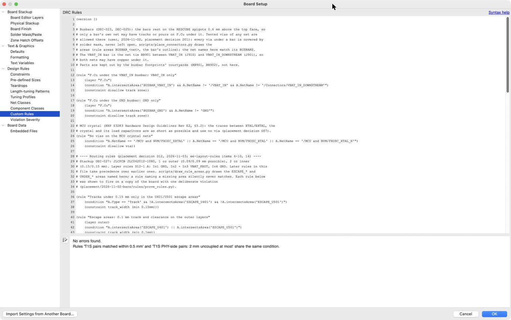

KiCad's syntax check reports no errors. It notes that "T1S pairs matched within 0.5 mm" and "T1S PHY-side pairs: 2 mm uncoupled at most" share a condition; that is deliberate (KiCad 10 never reported skew from the same rule as the coupling constraints).

`node60.kicad_dru`, in file order; later rules win. Each one was shown to fire on a copy of the board carrying one deliberate violation (`placement/2026-11-02-bars/rules/prove_rules.py`, 26 of 26 cases on 2026-11-04).

| Rule | What it does | Why |
|---|---|---|
| F.Cu under the VBAT_IN / GND busbar | Only the bar's own net(s) in F.Cu tracks and pours under each bar; tented vias of any net allowed | The bars rest on the board (DEC-023, DEC-025; D01) |
| No vias on the MCU crystal nets | XTAL/EXTAL traces without vias | NXP S32K3 hardware design guidelines (D07) |
| Tracks under 0.15 mm only in the U401/U501 escape areas | 0.10 mm tracks only where the BGA and PHY need them | D12 |
| Escape areas: 0.1 mm track and clearance on the outer layers | 0.10 / 0.10 mm in ESCAPE_U401, ESCAPE_U501 | JLCPCB 1 oz: 0.09 mm |
| Inner 2 oz layers: 0.15 mm track and clearance | 0.15 / 0.15 mm on In1–In4 | JLCPCB 2 oz: 0.15 mm |
| No vias on the buck switch nodes | Switch nodes stay on B.Cu | Keeps the hot loop small |
| 1V5_CORE_FB 1 mm from the switch nodes | Feedback away from switching noise | |
| Under Y401 / Y501 | Only their own nets and GND under the crystal and oscillator, on B.Cu and In4 | Keeps noise off the clocks |
| Plated holes 0.35 mm from other copper | Through-hole pads 0.35 mm from other nets on every layer | JLCPCB: PTH to track 0.28 mm minimum, **0.35 mm recommended** (raised from 0.30 mm on 2026-11-04) |
| High-current pads solid to their pours | No thermal spokes on the power stage's pads | Spokes would add resistance at 10–60 A |
| Silk text 1.0 mm high, 0.15 mm stroke | JLCPCB's silk minimum | Legible silk |
| T1S pairs coupled | Gap 0.14–0.16 mm | D16 |
| T1S PHY-side pairs: 2 mm uncoupled at most | | D16 |
| T1S pairs matched within 0.5 mm | Skew rule of its own (KiCad 10 never reported skew in the coupling rule) | D16 |
| T1S 0.75 mm from other nets | | Crosstalk |
| Buck switch nodes 10 mm from the T1S line | | Keeps switching noise off the bus |
| Thermal reliefs: one spoke is enough | Small parts' pads may join a pour through one spoke | Crowded power pours |

### Violation Severity

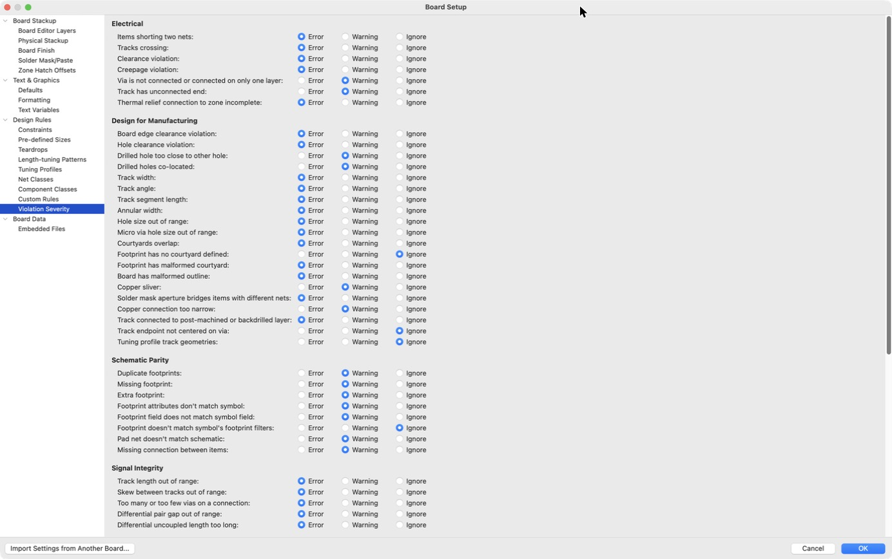

All KiCad defaults except **Missing connection between items: warning** (`unconnected_items`), set on 2026-10-30 while the board is being routed, so CI's DRC passes on an unrouted board. It goes back to error before routing is signed off and before any `rev-*` tag (see the project's deviations from the handbook).

## Rule areas

The custom rules refer to rule areas (KiCad keep-out zones) drawn on the board by scripts. They aren't in Board Setup:

| Areas | Drawn by | Re-run after |
|---|---|---|
| `BUSBAR_VBAT_IN`, `BUSBAR_GND` | `scripts/place_connectors.py` | Moving a terminal |
| `ESCAPE_U401`, `ESCAPE_U501`, `UNDER_Y401`, `UNDER_Y501` | `scripts/draw_rule_areas.py` | Moving U401, U501, Y401 or Y501 |
| `SIGNAL_WINDOW_In2Cu_1`, `POWER_ONLY_*` | `scripts/draw_rule_areas.py`, from `plan.json`'s `plane_windows` | Changing the layer roles |

## Checking the settings

CI runs DRC with errors and schematic parity:

```bash
kicad-cli pcb drc --severity-error --schematic-parity --exit-code-violations node60.kicad_pcb
```

To show that every custom rule still fires, run `placement/2026-11-02-bars/rules/prove_rules.py` with KiCad's Python from the repo root.

## Open with JLCPCB

- **Via annular ring on the 2 oz inner layers.** JLCPCB asks 0.254 mm of annular ring on 2 oz copper for plated through holes. It gives no via figure for 2 oz inner layers, and every via preset is under that: 0.075 mm on the 0.35 / 0.20 mm via, 0.10 mm on the Default 0.45 / 0.25 mm, 0.20 mm on the largest. Confirm with JLCPCB's engineering review before ordering: the order's DFM check, or a question to their support with the Gerbers. The board's vias keep their pad on every inner layer (none removes unused layers), so the question applies to every via on the board.
- **Silkscreen over pads.** DRC warns where silk overlaps pads. JLCPCB clips silk off the pads, so this is cosmetic.
