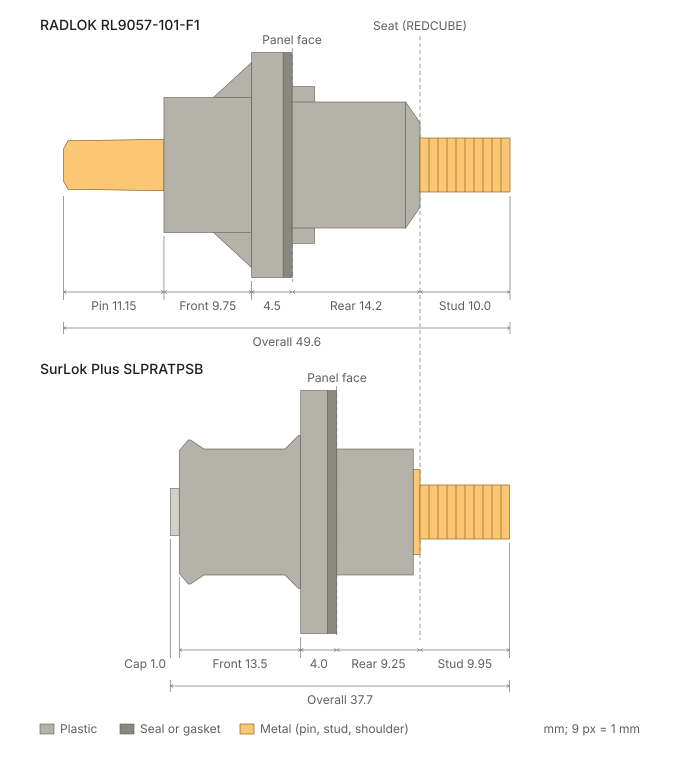
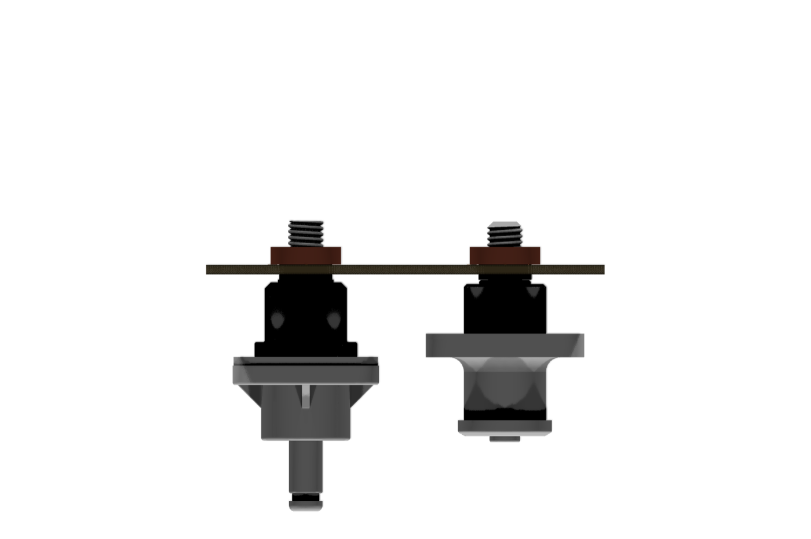
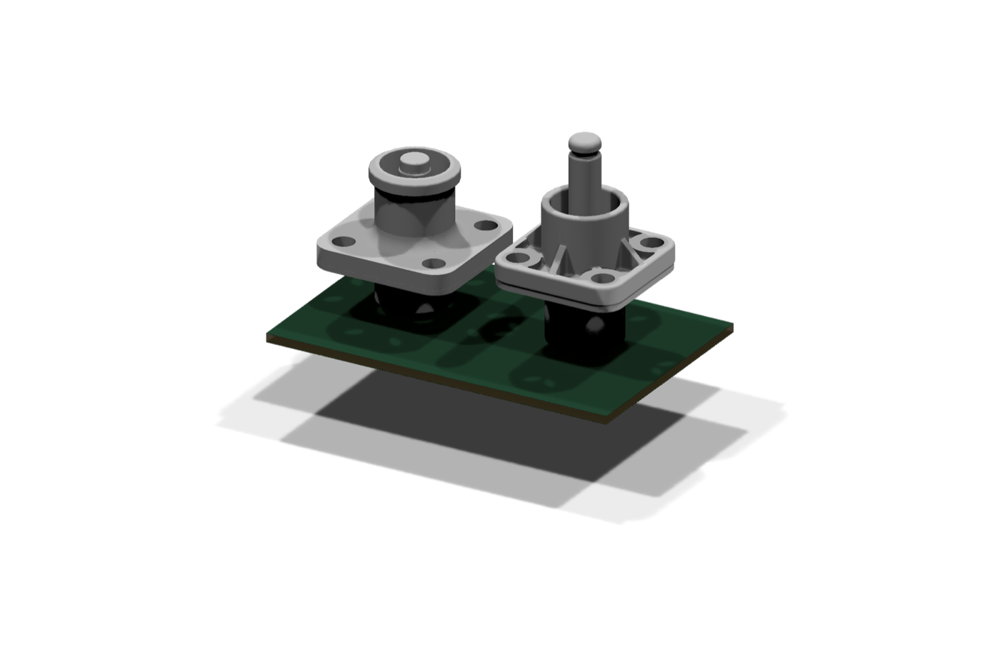

import { Aside } from '@astrojs/starlight/components';
import Ref from '../../../../components/Ref.astro';

Both power entries screw into a Würth REDCUBE 74660016R on the board (<Ref id="DEC-016" />): Amphenol SurLok Plus SLPRATPSB/R in versions 1 to 12, Amphenol RADLOK RL9057-101-F1 / -F1RE in [version 13](../v13/). Both are 5.7 mm RADSOK receptacles with an M6 × 1.0 stud. This page compares their lengths section by section, from Amphenol's own drawings and STEP models (<Ref id="S31" />, <Ref id="S32" />).

The drawing is to scale (9 px per mm), with both parts aligned on their **seating face**: the face that lands on the busbar or the REDCUBE spigot. The stud points right, into the board; the plug side is on the left.

## Sections

All lengths in mm, along the axis.

| Section | RADLOK RL9057-101-F1x | SurLok Plus SLPRATPSx |
|---|---|---|
| Stud, seat to tip (M6 × 1.0) | 10.0 | 9.95 (10.70 REF from the rear face, which includes a 0.75 hex shoulder) |
| Rear, seat to panel face | 13.35 (STEP; the drawing's I − H gives 14.2) | 9.25 (8.5 Ø14 body + 0.75 shoulder) |
| Flange and seal | 4.5, 25 mm square | 4.0: 3.0 flange (27 mm square, R4 corners) + 1.0 gasket |
| Front, flange to front face | 9.75: Ø15.0 tube on four gussets | 13.5: Ø14 tube with a Ø16 latch lip |
| Pin beyond the front face | 12.0, bare pin | 1.0, touch-proof cap only |
| Overall | 49.6 | 37.7 (36.7 to the front face) |
| In front of the panel | 26.25 | 18.5 |
| Behind the panel, to the stud tip | 23.35 | 19.2 |

Other differences:

- **Mating:** the RADLOK plug's Ø11.5 boss slides into the receptacle's Ø12.3 tube (9.6 deep) over the bare pin. The SurLok plug's skirt goes over the Ø16 lip and its nose into a Ø11.6–12.4 bore 19.75 deep, where the pin sits recessed.
- **Panel:** RADLOK needs a Ø14.7 hole with two key notches 18.2 across, in a panel 3 mm thick at most (the keys stop the housing turning). SurLok needs a plain Ø14.20 +0.20/0 hole (no-keyway version) and gives no thickness limit.
- **Screws:** 4 × M4 for both, on 17 × 17 (RADLOK) and 18 × 18 (SurLok).
- **Stud torque:** RADLOK 4.0 ± 0.4 N·m (drawing). SurLok 3 N·m on its M6 nut (catalogue IC-10 p. 13, <Ref id="S30" />).
- **Ratings:** both 120 A for 25 mm² and 1000 V. RADLOK −40 to +125 °C; SurLok −40 to +105 °C and IP67 mated. Amphenol's RADLOK pages give **IP40 mated** (<Ref id="S33" />, product pages).

## 3D views

Amphenol's own STEP models, each on a REDCUBE 74660016R at the same height, so the seats line up. The models are measured, not republished: they carry no licence.

<Aside type="note" title="Applied to the enclosure versions (2026-11-02)">
The enclosure geometry (`scripts/enclosure_geometry.py`, `RECEPTACLES`) used the SurLok figures from before Amphenol's drawing was found: a 7.7 mm stud (the library model's old estimate) and the catalogue's B − A − C (19.2) as seat to panel face. On the drawing and the STEP, 19.2 is the panel face to the stud **tip**: the seat is 9.25 below the panel face and the stud is 9.95 long. Both are corrected, with the 3.0 mm flange. The library's model is rebuilt to match (DropOut library PR #41). What moved is listed on the [Enclosure options](../) page.

Still open:

- **RADLOK sealing:** version 13 lists the RADLOK parts as IP67, but Amphenol Tuchel lists them as IP40 mated. Check with Amphenol before choosing RADLOK for a sealed node.
- **RADLOK depth:** the drawing gives 14.2 from seat to panel face and the STEP 13.35. Version 13 uses the drawing; confirm on a sample.
</Aside>

## Sources

- SurLok Plus: Amphenol customer drawing C10-730187 rev. F (2022-10-13) and customer STEP, from the SLPRATPSB product page (<Ref id="S31" />). The drawing is stamped as a controlled document, so it is archived privately (DropOut vendor docs) and not republished here. Catalogue IC-10 (<Ref id="S30" />).
- RADLOK: customer drawing "RADLOK Feed Thru Pin To Thread" rev. K (2022-04-25) and customer STEP, from the RL9057-101-F1 product page (<Ref id="S32" />); catalogue (<Ref id="S33" />).
- Measured on the STEP models for the DropOut library's receptacle models (`generators/custom/Amphenol_RADLOK_5.7mm.py` and `Amphenol_SurLok-Plus_SLPRAT.py`), 2026-11-01 and 2026-11-02.
